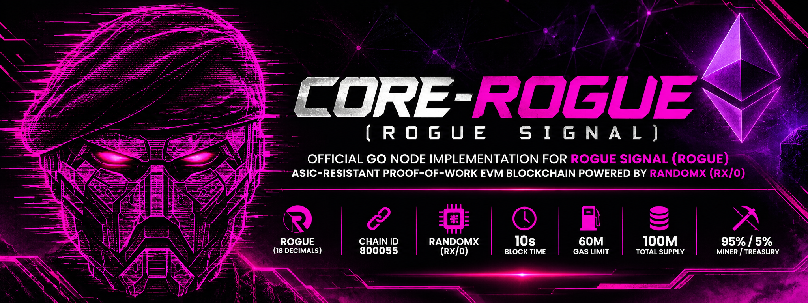

# Core-Rogue (Rogue Signal Node)



> Official Go client and node implementation for **Rogue Signal (ROGUE)** — a high-performance, ASIC-resistant Proof-of-Work EVM blockchain powered by **RandomX (`rx/0`)**.
> Built downstream from [etclabscore/core-geth](https://github.com/etclabscore/core-geth) to maintain 100% upstream EVM compatibility and long-term protocol upgradability.

---

## 📋 Table of Contents

- [Overview & Technical Specifications](#-overview--technical-specifications)
- [Monetary Policy & Halving Schedule](#-monetary-policy--halving-schedule)
- [Architecture & Internal Modifications](#-architecture--internal-modifications)
  - [Consensus Package (`consensus/randomx`)](#1-consensus-package-consensusrandomx)
  - [Parameters & Genesis (`params/`)](#2-parameters--genesis-params)
  - [Backend & Engine Dispatch (`eth/`)](#3-backend--engine-dispatch-eth)
  - [CLI Flags & Port Management (`cmd/utils/`)](#4-cli-flags--port-management-cmdutils)
- [Building from Source (Native, No Docker)](#-building-from-source-native-no-docker)
  - [Prerequisites](#prerequisites)
  - [Compilation on Linux](#compilation-on-linux)
  - [Compilation on macOS](#compilation-on-macos)
  - [Compilation on Windows](#compilation-on-windows)
  - [Automation & Release Scripts (`scripts/`)](#-automation--release-scripts-scripts)
- [Running Unit & Consensus Tests](#-running-unit--consensus-tests)
- [Node Operations & Useful Commands](#-node-operations--useful-commands)
  - [1. Initializing the Blockchain](#1-initializing-the-blockchain)
  - [2. Starting a Full Validator Node](#2-starting-a-full-validator-node)
  - [3. Running a Local Mining Node](#3-running-a-local-mining-node)
  - [4. Enabling Fast Mode (~2.08 GB RAM)](#4-enabling-fast-mode-208-gb-ram)
  - [5. Attaching to JavaScript Console (IPC / RPC)](#5-attaching-to-javascript-console-ipc--rpc)
  - [6. Useful JavaScript Console Commands](#6-useful-javascript-console-commands)
- [JSON-RPC & Web3 Developer Guide](#-json-rpc--web3-developer-guide)
  - [Testing with `curl`](#testing-with-curl)
  - [Connecting with MetaMask](#connecting-with-metamask)
  - [Foundry / Hardhat Integration](#foundry--hardhat-integration)
- [Egalitarian Home CPU Mining Architecture](#-egalitarian-home-cpu-mining-architecture)
- [Upstream Synchronization & Git Hygiene](#-upstream-synchronization--git-hygiene)

---

## 🚀 Overview & Technical Specifications

| Parameter | Value | Technical Details |
| :--- | :--- | :--- |
| **Network Name** | **Rogue Signal** | Canonical network designation |
| **Native Currency** | **ROGUE** | 18 decimals (`10^18` wei per ROGUE) |
| **Chain ID** | **`800055`** | Strict EIP-155 replay protection active from block 0 |
| **Mining Algorithm**| **RandomX (`rx/0`)** | Native ASIC/GPU-resistant CPU Proof-of-Work |
| **Default RAM Profile**| **Light Mode (~256 MB RAM)** | Default profile optimized for home computers and low-memory hardware |
| **Optional RAM Profile**| **Fast Mode (~2.08 GB RAM)** | Activated only when both `--mine` and `--randomx.fast` are enabled (otherwise Light Mode) |
| **VM Pool Architecture** | **Elastic Bounded Channel (`NumCPU + 2`)** | Parallel `GOMAXPROCS` prewarm, zero GC churn, thread-local `AcquireVM`/`ReleaseVM`, lazy atomic refcounting |
| **Block Target Time** | **30 seconds** | Low-orphan global cadence (`< 0.5%` orphan rate) without Uncles |
| **Gas Limit** | **50,000,000** per block | High transaction bandwidth (`1 Gwei` min TxPool floor, 128 MB TxPool RAM cap, legacy tx type 0 only) |
| **Difficulty Algorithm** | **LWMA-1** ($N=60$) | Linear Weighted Moving Average (~30m window, candidate timestamp independent) |
| **Target Clamping** | **$\pm 33\%$ per block** | Clamps adjustment to $[67\%, 133\%]$ to prevent hashrate shock attacks |
| **Genesis Difficulty** | `0x10000` (65,536) | Calibrated initial difficulty for home CPU bootstrap |
| **Timestamp Rules** | **Strict MTP-11** | Block time must exceed Past Median Time of past 11 blocks; max 30s future drift |
| **Anti-51% Finality** | **ECBP-1100 (MESS) from Block 0** | Pure ECBP-1100 polynomial gravity (up to $31\times$ TD, 15m safety interval) + Anti-Selfish tie-breaking |
| **Header Limits** | **`MaxExtraDataSize = 64` bytes** | Anti-bloat cap + two-phase fail-fast parallel `VerifyHeaders` |
| **Total Max Supply** | **100,000,000 ROGUE** | Exact mathematical hard cap across 32 halving eras (zero tail emission) |
| **Initial Block Reward**| **25 ROGUE** | Halves every 2,000,000 blocks (~1.90 years at 30s/block) |
| **Reward Split** | **95% Miner / 5% Treasury** | 23.75 ROGUE to miner coinbase (+ 100% tx fees), 1.25 ROGUE to protocol treasury |
| **Treasury Address** | `0xe9aaE535B7971A9AC8C6af0e4B524D02260D3a03` | Hardcoded default fallback; configurable in `genesis.json` |
| **Uncle Blocks** | **Strictly Forbidden (0%)** | Uncle headers rejected (`ErrUnclesNotAllowed`), simplifying state tree |
| **Seed Rotation** | **Every 2048 blocks (~17.07h)** | Rotates RandomX VM key every 2048 blocks with canonical reorg validation |
| **Seed Lag** | **64 blocks (~32m)** | Next epoch seed is locked 64 blocks early (`runtime.NumCPU()/2` precompute) |
| **Cache Retention** | **128 blocks (~64m)** | Retains previous epoch cache in RAM to validate chain reorganizations |
| **Genesis Block Hash** | `0xf30f172028b07950de58d2cb4d65593793c183fcd0f86c9c24c5d4a037b490b7` | Anchored in `RequireBlockHashes[0]` |
| **SealHash Format** | RLP(Header without Nonce & MixDigest) | Canonical Ethereum RLP serialization excluding mutable seal fields |
| **MixDigest** | 32-byte RandomX hash | Direct PoW inclusion proof stored in header |
| **Default P2P Port** | **`38888`** | Dedicated port avoiding Ethereum/ETC discovery collisions |
| **Default HTTP RPC** | **`38845`** | Dedicated JSON-RPC HTTP port |
| **Default WS RPC** | **`38846`** | Dedicated WebSocket port |
| **Remote Mining RPC** | **Disabled** | `eth_getWork` and `eth_submitWork` are disabled to block Stratum pools and rigs |
| **EVM Fork Base** | **Cancun / Shanghai (Classical PoW)** | `PUSH0`, `MCOPY`, `TSTORE/TLOAD` enabled from block 0 (100% fees to miner) |
| **Miner Gamification**| **7 Cyberpunk Tiers** | On-chain persistence in `StateDB` at `0x...0020`, queried via `rogue_getMinerLevel` / `rogue_getMinerStats` |

---

## 💰 Monetary Policy & Halving Schedule

Rogue Signal implements a strictly disinflationary emission model inspired by Bitcoin, calibrated for a 30-second block cadence:

$$\text{Era} = \left\lfloor \frac{\text{BlockNumber} - 1}{2,000,000} \right\rfloor$$
$$\text{Reward} = \left\lfloor \frac{25 \times 10^{18}}{2^{\text{Era}}} \right\rfloor \text{ wei}$$

* **Era 0 (Blocks 1 – 2,000,000 / ~Years 0–1.9)**: 25 ROGUE per block (23.75 ROGUE miner / 1.25 ROGUE treasury). **50,000,000 ROGUE minted**.
* **Era 1 (Blocks 2,000,001 – 4,000,000 / ~Years 1.9–3.8)**: 12.5 ROGUE per block (11.875 ROGUE miner / 0.625 ROGUE treasury). **25,000,000 ROGUE minted**.
* **Era 2 (Blocks 4,000,001 – 6,000,000 / ~Years 3.8–5.7)**: 6.25 ROGUE per block (5.9375 ROGUE miner / 0.3125 ROGUE treasury). **12,500,000 ROGUE minted**.
* **Era 3 (Blocks 6,000,001 – 8,000,000 / ~Years 5.7–7.6)**: 3.125 ROGUE per block (2.96875 ROGUE miner / 0.15625 ROGUE treasury). **6,250,000 ROGUE minted**.
* **Eras 4 – 31**: Exponential reduction halving every 2.0M blocks.
* **Era 32+**: **0 ROGUE (Absolute Zero)**. After 100M ROGUE are minted ($25 \times 2,000,000 \times 2 = 100,000,000$), the block subsidy is permanently terminated. Miners are sustained 100% by transaction gas fees.

---

## 🏗️ Architecture & Internal Modifications

```
                     Core-Geth Node Architecture
┌────────────────────────────────────────────────────────────────────────┐
│                          JSON-RPC / Web3 API                           │
│           eth_blockNumber, eth_getBalance, eth_sendRawTransaction      │
└───────────────────────────────────┬────────────────────────────────────┘
                                    │
┌───────────────────────────────────▼────────────────────────────────────┐
│                    Ethereum Execution Layer (core/)                    │
│      EVM State Processor (Cancun / Shanghai opcodes active at block 0) │
│                       Pebble Database State Engine                     │
└───────────────────────────────────┬────────────────────────────────────┘
                                    │ consensus.Engine
┌───────────────────────────────────▼────────────────────────────────────┐
│                   consensus/randomx (Engine Interface)                 │
│                                                                        │
│  ├── difficulty.go : LWMA-1 (N=60, T=30s, clamp +-33%, MTP-11)         │
│  ├── rewards.go    : 25 ROGUE base, 2.0M halving, 95%/5% split, 100M   │
│  ├── epoch.go      : 2048-block epoch manager, 64-block lag, reorg safe│
│  ├── gamification.go: StateDB persistence at 0x...0020, 7 Cyberpunk ranks│
│  ├── randomx.go    : SealHash, 2-phase VerifyHeaders, MaxExtraData 64B │
│  └── rx_cgo.go     : CGO bindings to librandomx.a (UAF-safe RLock)     │
└───────────────────────────────────┬────────────────────────────────────┘
                                    │ CGO Static Linking
┌───────────────────────────────────▼────────────────────────────────────┐
│                       librandomx.a (Native C++)                        │
│          Hardware AES, JIT Compiler, Argon2d, Superscalar CPU          │
└────────────────────────────────────────────────────────────────────────┘
```

### 1. Consensus Package (`consensus/randomx`)
- **`rx_cgo.go`**: Provides thread-safe Go bindings to `librandomx.a`.
  - Implements `RxContext` containing an initialized `randomx_cache` (~256 MB) or `randomx_dataset` (~2.08 GB).
  - Uses an elastic bounded `randomx_vm` pool (`chan *VM`) with atomic reference counting across worker goroutines, avoiding allocation overhead during verification or mining.
- **`difficulty.go`**: Implements Zawy's **LWMA-1** algorithm.
  - Dynamically bootstraps for initial blocks ($H < 60$) using $k = \min(60, H)$.
  - Applies target clamping limiting difficulty shifts to $[67\%, 133\%]$ per block.
  - Implements `CalculateMTP11` checking that each block timestamp exceeds the median of the past 11 blocks.
- **`rewards.go`**: Calculates the halving emission curve and splits rewards between miner coinbase (95%) and protocol treasury (5%). Triggers `RecordMinedBlock` for Block > 0.
- **`gamification.go`**: Implements protocol-level on-chain miner levels and cyberpunk ranks:
  - Stores canonical mined block count inside `StateDB` under contract `0x0000000000000000000000000000000000000020`.
  - Calculates deterministic progression through 7 ranks (Level 0 *Unranked Runner* to Level 6 *Rogue Singularity*).
  - Handles reorganization rewinding natively with the canonical state trie.
- **`api.go`**: Exposes the `rogue` and `randomx` RPC namespaces (`rogue_getMinerLevel`, `rogue_getMinerStats`, `rogue_getConsensusStatus`, `randomx_getEpochInfo`).
- **`epoch.go`**: Coordinates RandomX seed rotation every 2048 blocks.
  - Sets seed at block $E \times 2048 - 64$.
  - Precomputes the upcoming epoch cache asynchronously in a background goroutine during the 64-block lag window.
  - Retains the previous epoch's cache for 128 blocks to allow reorganization validation without CPU freezing.
- **`randomx.go`**: Full implementation of the `consensus.Engine` interface.
  - `SealHash`: Calculates canonical Keccak256 hash of header fields, excluding Nonce and MixDigest.
  - `MiningInput`: Packs 32-byte `SealHash` and 8-byte little-endian `Nonce` into a standard 76-byte RandomX mining blob (`rx/0`).
  - `VerifySeal`: Validates that `HashToBig(RandomX(input)) <= Target` and `header.MixDigest == RandomX(input)`.
  - `VerifyUncles`: Enforces 0 uncles (rejects blocks with uncles via `ErrUnclesNotAllowed`).
  - `Seal`: Multithreaded local miner loop for tests and solo mining.

### 2. Parameters & Genesis (`params/`)
- **`params/types/ctypes/types.go`**:
  - Added `ConsensusEngineT_RandomX` to `ConsensusEngineT` enum.
  - Added `RandomXConfig` struct with `FastMode` and `Treasury` fields.
- **`params/config_rogue.go`**:
  - Added `RogueChainConfig` setting Chain ID `800055`, Cancun opcodes (`PUSH0`, `MCOPY`, `TSTORE/TLOAD`) from block 0, and default treasury `0xe9aaE535B7971A9AC8C6af0e4B524D02260D3a03`.
- **`params/genesis_rogue.go`**:
  - Added `DefaultRogueGenesisBlock()` setting 60M gas limit, `0x10000` difficulty, and empty alloc (0% premine).
- **`params/types/goethereum/goethereum.go`**:
  - Registered `"800055": "rogue-signal"` in network names.
  - Updated chain banner to display: `Consensus: RandomX rx/0 (proof-of-work, ASIC-resistant)`.

### 3. Backend & Engine Dispatch (`eth/` & `miner/`)
- **`eth/sync.go`**:
  - Calibrated `artificialFinalitySafetyInterval = 30 * 30 * time.Second` (15 minutes), adapting MESS to Rogue Signal's 30s block cadence.
- **`miner/worker.go` & `miner/miner.go`**:
  - Suppresses preliminary empty block commit when TxPool is empty, avoiding CPU interruptions on RandomX.
  - Atomically deduplicates sealing tasks by `sealhash` per block head.
  - Default `miner.recommit` set to 10 seconds.
- **`eth/ethconfig/config.go`**:
  - Added `RandomXFast bool` configuration flag.
  - Extended `CreateConsensusEngine` to instantiate `randomx.New(*randomxConfig)` when RandomX is specified.
- **`eth/backend.go`**:
  - Loads `chainConfig` from database and inspects `chainConfig.GetConsensusEngineType()`.
  - Automatically dispatches `RandomX` consensus engine without falling back to Ethash or generating DAGs.

### 4. CLI Flags & Port Management (`cmd/utils/`)
- **`cmd/utils/flags.go`**:
  - Added `--rogue` flag to load Rogue Signal network configuration.
  - Added `--randomx.fast` flag to toggle Fast Mode.
  - Overrides default ports automatically when `--rogue` is passed:
    - P2P Port: `38888` (default: 30303)
    - HTTP RPC: `38845` (default: 8545)
    - WebSocket: `38846` (default: 8546)
  - Configures data directory to `<datadir>/rogue` by default.

---

## 🛠️ Building from Source (Native, No Docker)

Core-Rogue compiles `librandomx` statically from source and links it directly into the binary.

### Prerequisites

| Tool | Minimum Version | Installation Command (Ubuntu/Debian) | Installation Command (macOS) |
| :--- | :--- | :--- | :--- |
| **Go** | 1.24+ | `sudo apt install golang` | `brew install go` |
| **CMake** | 3.15+ | `sudo apt install cmake` | `brew install cmake` |
| **C/C++ Compiler** | GCC 9+ / Clang 10+ | `sudo apt install build-essential` | `xcode-select --install` |

### Compilation on Linux

```bash
# 1. Clone repository with submodules
git clone --recurse-submodules https://github.com/roguesignalchain/core-rogue.git
cd core-rogue

# 2. Build the RandomX static library and core-rogue binary
make core-rogue
```

The resulting standalone executable is generated at:
```bash
./build/bin/core-rogue       # Node daemon with built-in RandomX CPU miner
```

### Compilation on macOS

```bash
# Install toolchain
brew install go cmake

# Clone and compile
git clone --recurse-submodules https://github.com/roguesignalchain/core-rogue.git
cd core-rogue
make core-rogue
```

### Compilation on Windows

1. Install [Go for Windows](https://go.dev/dl/) and [CMake](https://cmake.org/download/).
2. Install [MinGW-w64](https://www.mingw-w64.org/) and add `gcc` / `mingw32-make` to your system `PATH`.
3. In PowerShell or Command Prompt:
```cmd
git clone --recurse-submodules https://github.com/roguesignalchain/core-rogue.git
cd core-rogue
mingw32-make core-rogue
```

### Automation & Release Scripts (`scripts/`)

The repository includes a suite of native automation scripts in [`scripts/`](file:///media/carlos/DATA1/DEV/blockchain_pow/rogue-core-chain/scripts) for builds, headless CLI packaging, service deployment, and pre-release audits:

| Script | Purpose | Usage |
| :--- | :--- | :--- |
| [`scripts/build-core.sh`](file:///media/carlos/DATA1/DEV/blockchain_pow/rogue-core-chain/scripts/build-core.sh) | Compiles `librandomx.a` and `core-rogue` with Git metadata injection and updates desktop sidecar if present. | `./scripts/build-core.sh` |
| [`scripts/package-cli.sh`](file:///media/carlos/DATA1/DEV/blockchain_pow/rogue-core-chain/scripts/package-cli.sh) | Bundles standalone `rogue-core-cli` tarball with binary, genesis config, systemd installer, and SHA256 checksum into `dist/`. (Also invoked via `make dist`). | `make dist` or `./scripts/package-cli.sh` |
| [`scripts/install-service.sh`](file:///media/carlos/DATA1/DEV/blockchain_pow/rogue-core-chain/scripts/install-service.sh) | AI-ready unattended or interactive systemd service installer (`--user` or `--system`). Initializes genesis automatically. | `./scripts/install-service.sh --user` |
| [`scripts/verify-release.sh`](file:///media/carlos/DATA1/DEV/blockchain_pow/rogue-core-chain/scripts/verify-release.sh) | Automated pre-release audit: checks zero secrets/wallets, compiles core, checks sidecar, and verifies git cleanliness. | `./scripts/verify-release.sh` |
| [`scripts/build-windows.ps1`](file:///media/carlos/DATA1/DEV/blockchain_pow/rogue-core-chain/scripts/build-windows.ps1) | PowerShell build script for MinGW-w64 on Windows (`librandomx.a`, `core-rogue.exe`, and optional desktop installer). | `powershell -ExecutionPolicy Bypass -File .\scripts\build-windows.ps1` |
| [`scripts/clean-remote-tags.sh`](file:///media/carlos/DATA1/DEV/blockchain_pow/rogue-core-chain/scripts/clean-remote-tags.sh) | Cleans legacy upstream tags from GitHub origin to maintain clean release tags. | `./scripts/clean-remote-tags.sh` |

---

## 🧪 Running Unit & Consensus Tests

To run the complete suite of RandomX unit tests, official vector validations, and integration tests:

```bash
# Test all consensus/randomx packages
cd consensus/randomx
CGO_ENABLED=1 go test -v .
cd ../..

# Run specific test suites
CGO_ENABLED=1 go test -v -run TestOfficialRandomXVectorsLightMode ./consensus/randomx  # Official RandomX test vectors
CGO_ENABLED=1 go test -v -run TestConcurrentHashing               # Thread-safety VM pool test
CGO_ENABLED=1 go test -v -run TestDifficultyTargetConversion      # Target & difficulty math
CGO_ENABLED=1 go test -v -run TestLWMAAdjusts                     # LWMA-1 difficulty adjustment
CGO_ENABLED=1 go test -v -run TestMTP11StrictValidation           # Strict MTP-11 time rules
CGO_ENABLED=1 go test -v -run TestBlockRewardHalving              # 2-year halving schedule
CGO_ENABLED=1 go test -v -run TestSplitReward                     # 95% miner / 5% treasury split
CGO_ENABLED=1 go test -v -run TestMaxSupplyCapCompliance          # 100M hard cap compliance
CGO_ENABLED=1 go test -v -run TestEpochCalculations               # 2048-block epoch & lag math
CGO_ENABLED=1 go test -v -run TestSealAndVerifySealIntegration    # End-to-end RandomX block mining & verification
```

---

## 💻 Node Operations & Useful Commands

### 1. Initializing the Blockchain

Before starting a node for the first time, initialize its database with `genesis.json`:

```bash
# Initialize custom datadir
./build/bin/core-rogue --datadir /path/to/data init genesis.json
```

Output confirmation:
```
INFO Wrote genesis block OK config="Chain ID: 800055 (rogue-signal) Consensus: RandomX rx/0 (proof-of-work, ASIC-resistant)"
INFO Successfully wrote genesis state database=chaindata hash=fbdc74..8a1a27
```

### 2. Starting a Full Validator Node

Starts a validating node listening on dedicated Rogue Signal ports (**P2P: `38888`**, **RPC: `38845`**, **WS: `38846`**):

```bash
./build/bin/core-rogue \
  --datadir /path/to/data \
  --rogue \
  --http \
  --http.addr 127.0.0.1 \
  --http.port 38845 \
  --http.api eth,net,web3,personal,txpool \
  --http.corsdomain "*" \
  --ws \
  --ws.addr 127.0.0.1 \
  --ws.port 38846 \
  --ws.api eth,net,web3 \
  --port 38888
```

### 3. Running a Local Mining Node

To mine blocks using the internal CPU miner:

```bash
./build/bin/core-rogue \
  --datadir /path/to/data \
  --rogue \
  --mine \
  --miner.etherbase 0xe9aaE535B7971A9AC8C6af0e4B524D02260D3a03 \
  --miner.threads 2 \
  --http \
  --http.port 38845
```

### 4. Enabling Fast Mode (~2.08 GB RAM)

By default, Core-Rogue operates in **Light Mode (~256 MB RAM)** so it can run smoothly on low-resource machines. On dedicated servers, pools, or high-end nodes with $\ge 4\text{ GB}$ of RAM, enable **Fast Mode** for instant hash verification:

```bash
./build/bin/core-rogue \
  --datadir /path/to/data \
  --rogue \
  --randomx.fast \
  --mine \
  --miner.etherbase <YOUR_WALLET_ADDRESS>
```

### 5. Attaching to JavaScript Console (IPC / RPC)

Attach to an actively running node:

```bash
# Attach via local IPC socket
./build/bin/core-rogue attach /path/to/data/geth.ipc

# Or attach via HTTP RPC
./build/bin/core-rogue attach http://127.0.0.1:38845
```

### 6. Useful JavaScript Console Commands

Once connected to the console:

```javascript
// Check current block number
eth.blockNumber

// Check latest block details
eth.getBlock("latest")

// Check account balance in ROGUE
web3.fromWei(eth.getBalance("0xe9aaE535B7971A9AC8C6af0e4B524D02260D3a03"), "ether")

// Check mining status and hashrate
eth.mining
eth.hashrate

// Start / stop miner with N threads
miner.start(2)
miner.stop()

// Check connected P2P peers
net.peerCount
admin.peers

// Check transaction pool status
txpool.status
```

---

## 🌐 JSON-RPC & Web3 Developer Guide

### Testing with `curl`

#### Check Chain ID (Returns `0xc3517` = 800055):
```bash
curl -X POST http://127.0.0.1:38845 \
  -H "Content-Type: application/json" \
  --data '{"jsonrpc":"2.0","method":"eth_chainId","params":[],"id":1}'
```

#### Get Latest Block Number:
```bash
curl -X POST http://127.0.0.1:38845 \
  -H "Content-Type: application/json" \
  --data '{"jsonrpc":"2.0","method":"eth_blockNumber","params":[],"id":1}'
```

#### Check Treasury Balance:
```bash
curl -X POST http://127.0.0.1:38845 \
  -H "Content-Type: application/json" \
  --data '{"jsonrpc":"2.0","method":"eth_getBalance","params":["0xe9aaE535B7971A9AC8C6af0e4B524D02260D3a03","latest"],"id":1}'
```

#### Query Miner Cyberpunk Level (`rogue_getMinerLevel`):
```bash
curl -X POST http://127.0.0.1:38845 \
  -H "Content-Type: application/json" \
  --data '{"jsonrpc":"2.0","method":"rogue_getMinerLevel","params":["0xYourMinerAddress"],"id":1}'
```

#### Query Detailed Miner Progression Stats (`rogue_getMinerStats`):
```bash
curl -X POST http://127.0.0.1:38845 \
  -H "Content-Type: application/json" \
  --data '{"jsonrpc":"2.0","method":"rogue_getMinerStats","params":["0xYourMinerAddress"],"id":1}'
```
Response:
```json
{
  "jsonrpc": "2.0",
  "id": 1,
  "result": {
    "address": "0xYourMinerAddress",
    "blocksMined": 142,
    "level": 3,
    "title": "Hash Warden",
    "currentXP": 142,
    "nextLevelXP": 500,
    "progressPercent": 28.4
  }
}
```

#### Query Consensus Telemetry (`rogue_getConsensusStatus`):
```bash
curl -X POST http://127.0.0.1:38845 \
  -H "Content-Type: application/json" \
  --data '{"jsonrpc":"2.0","method":"rogue_getConsensusStatus","params":[],"id":1}'
```

### Connecting with MetaMask

You can add Rogue Signal directly to MetaMask or any EVM-compatible wallet:

* **Network Name**: `Rogue Signal`
* **New RPC URL**: `http://127.0.0.1:38845` (or your public node IP)
* **Chain ID**: `800055`
* **Currency Symbol**: `ROGUE`
* **Block Explorer URL**: *(configured upon explorer deployment)*

### Foundry / Hardhat Integration

Because Rogue Signal implements standard Cancun opcodes, tools like **Foundry** work out of the box:

```bash
# Deploy a contract using Foundry
forge create --rpc-url http://127.0.0.1:38845 \
  --private-key <YOUR_PRIVATE_KEY> \
  src/MyToken.sol:MyToken
```

---

## 🎖️ Protocol-Level Gamification & Cyberpunk Miner Tiers

Rogue Signal pioneers protocol-enforced miner progression without monetary distortion. The network tracks solo miner blocks natively in the EVM state trie at system address `0x0000000000000000000000000000000000000020` (`keccak256(miner.Bytes())`), active from Block 1 onwards with strict reorg safety ($\le 90$ blocks).

Miners progress through 7 cyberpunk tiers strictly via cryptographic work:

| Level | Rank Title | Blocks Mined | Target XP | Badge Asset | Status |
| :---: | :--- | :---: | :---: | :---: | :---: |
| **Lv.0** | **Unranked Runner** | `0` | `1` | `lvl0.png` | `Active` |
| **Lv.1** | **Recon Runner** | `1 – 24` | `25` | `lvl1.png` | `Active` |
| **Lv.2** | **Signal Scraper** | `25 – 99` | `100` | `lvl2.png` | `Active` |
| **Lv.3** | **Hash Warden** | `100 – 499` | `500` | `lvl3.png` | `Active` |
| **Lv.4** | **Cipher Architect** | `500 – 2,499` | `2,500` | `lvl4.png` | `Active` |
| **Lv.5** | **Apex Operator** | `2,500 – 9,999` | `10,000` | `lvl5.png` | `Active` |
| **Lv.6** | **Rogue Singularity** | `10,000+` | `MAX` | `lvl6.png` | `Legendary` |

---

## ⛏️ Egalitarian Home CPU Mining Architecture

Rogue Signal is designed strictly for decentralized solo mining on standard home computers (*1 CPU = 1 Vote*):

1. **Integrated In-Node CPU Mining Only**: Managed directly via the official **Rogue Desktop Client** (`miner_start` / `miner_stop`) or CLI node flags (`core-rogue --mine --miner.threads N`).
2. **Remote Mining & Stratum Disabled**: External mining RPC endpoints (`eth_getWork`, `eth_submitWork`, `eth_submitHashrate`) are disabled at the consensus engine level to prevent external Stratum proxies, mining pools, and specialized mining rigs from centralizing network hashrate.
3. **Default Light Mode (~256 MB RAM)**: Nodes initialize in RandomX Light Mode by default so any home desktop or laptop can validate and mine blocks safely alongside everyday applications, with optional Fast Mode (~2.08 GB RAM) available via `--randomx.fast` or RPC `randomx_setFastMode`.

---

## 🔄 Upstream Synchronization & Git Hygiene

Core-Rogue follows strict upstream tracking with Core-Geth:

* **`origin`**: `https://github.com/roguesignalchain/core-rogue.git` (Project repository).
* **`upstream`**: `https://github.com/etclabscore/core-geth.git` (Base repository).

### Pulling Upstream Updates:
```bash
git fetch upstream master
git merge upstream/master
```

### Updating RandomX Submodule:
```bash
git submodule update --remote --recursive
```

### Git Commit Conventions:
All contributions must adhere to standard project conventions:
- **Format**: Conventional Commits (`feat(...)`, `fix(...)`, `build(...)`, `docs(...)`).
- **Author**: Single author `cjbaezilla <carlos.baeza@gmail.com>`. No co-authorship tags.
- **Hygiene**: Never commit build artifacts (`build/`, `*.a`, binaries).
